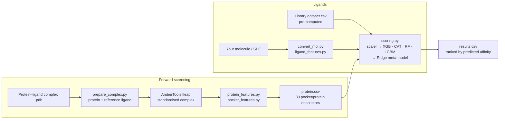
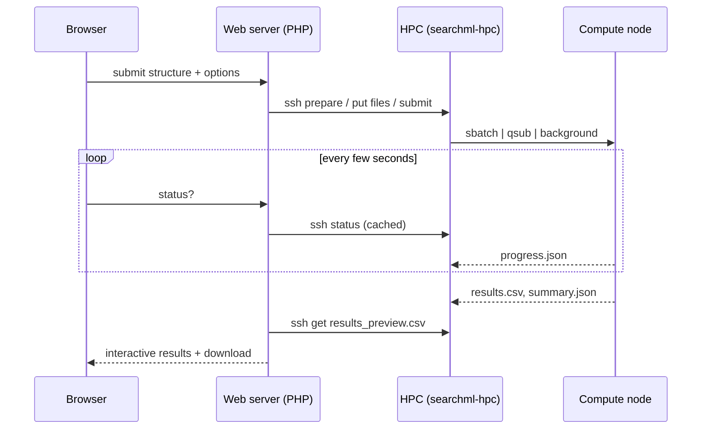

# SEARCH-ML

**S**creening & **E**nsemble **A**nalysis for **R**eceptors and **C**hemical **H**its with **ML**

[](https://github.com/SimulatedLife/search-ml/actions/workflows/ci.yml)


SEARCH-ML predicts protein–ligand binding affinity with a stacked machine-learning
ensemble (XGBoost, CatBoost, Random Forest and LightGBM blended by a Ridge
meta-model) trained on 11,689 experimentally characterised complexes from
PDBbind v2020. Because it scores descriptors instead of docking poses, it screens
millions of molecules on ordinary CPUs.

It works in two directions:

| | Input | Screened against | Answers |
|---|---|---|---|
| **Forward screening** | a protein structure with a bound reference ligand | compound libraries (DrugBank, FDA, BIMP, ChEMBL, ZINC, PubChem, …), one molecule, or your own SDF | *Which molecules may bind this pocket?* |
| **Reverse screening** | one small molecule | pre-computed protein pockets (e.g. 80,000 human pockets) | *Which proteins may this molecule bind?* |

Use it on the free web server — **<https://scfbio.iitd.ac.in/search-ml/>** — or run it
on your own workstation or cluster with this repository.

---

## Contents

- [What's new in 2.0](#whats-new-in-20)
- [How it works](#how-it-works)
- [Installation](#installation)
- [Quick start](#quick-start)
- [Usage](#usage)
- [Outputs](#outputs)
- [Libraries](#compound-and-target-libraries)
- [Running web-portal jobs on your HPC](#running-web-portal-jobs-on-your-hpc)
- [Repository layout](#repository-layout)
- [Troubleshooting](#troubleshooting)
- [Citation](#citation) · [License](#license) · [Contact](#contact)

## What's new in 2.0

- **Bug fixes that change results:** SINGLE and CUSTOM modes now work (they called a
  script that did not exist); in SINGLE, CUSTOM and reverse modes the meta-model now
  receives the base-model predictions in the trained order (CatBoost and XGBoost were
  swapped before because the order file was not found).
- **One pipeline for everything** — `scripts/pipeline.py` drives the command-line
  scripts and the web-portal jobs, with clear error messages, exit codes and live
  progress (`progress.json`).
- **Scales to 100M-molecule libraries:** streaming, filter-before-predict, optional
  parallel workers and a disk-based sort keep memory bounded.
- **Exact reference-ligand selection** (`9UM:A:413`) and a `--list` helper to see the
  ligands in a PDB file.
- **User molecules are prepared like the reference libraries:** 2D or hydrogen-less SDF
  entries are protonated and embedded in 3D before descriptors are computed.
- **HPC job runner** (`hpc/`) for the web portal: SLURM, PBS or plain background
  execution, an installer, a restricted SSH gateway and a self-test.
- Tests and continuous integration; a minimal, pinned `environment.yml` that now
  includes RDKit.

See [CHANGELOG.md](CHANGELOG.md) for the full list.

## How it works



Each prediction combines 25 ligand descriptors (size, polarity, shape, flexibility) with
38 protein and pocket descriptors (composition, charge, hydrophobicity, volume,
surface area). The ensemble outputs a pKi/pKd/pIC50-like value, reported as
`PBE (pKi/pKd/pIC50)`, `PBE (kcal/mol)` (ΔG = −1.364 × pKi) and `PBE (nM)`.

Held-out test performance (5% of the data, never seen in training): **Pearson R 0.85,
R² 0.72, RMSE 1.01 pKi units** (about 1.4 kcal/mol). Details and plots:
<https://scfbio.iitd.ac.in/search-ml/about.php>.

## Installation

Requirements: Linux, macOS or Windows with WSL2; [Miniforge](https://github.com/conda-forge/miniforge)
(or Miniconda/Anaconda); about 6 GB of disk for the environment, models and bundled libraries.

```bash
git clone https://github.com/SimulatedLife/search-ml.git
cd search-ml
./install.sh
```

`install.sh` creates the `search-ml` conda environment (Python 3.10, AmberTools 24,
RDKit, scikit-learn 1.7.1, XGBoost 3.0.4, LightGBM 4.6.0, CatBoost 1.2.8), records
`SEARCH_ML_HOME`, and downloads the Random Forest model (~830 MB, too large for
GitHub) into `models/` after asking, verifying its SHA-256 checksum. AmberTools is
large, so the first install takes 10–30 minutes.

Then activate the environment in every new terminal:

```bash
conda activate search-ml
python scripts/pipeline.py check        # verifies RDKit, Biopython, tleap and the models
```

<details>
<summary><b>Manual installation / Windows (WSL2)</b></summary>

Manual steps:

```bash
conda env create -f environment.yml
conda env config vars set SEARCH_ML_HOME="$(pwd)" -n search-ml
conda activate search-ml
# Random Forest model: https://scfbio.iitd.ac.in/search-ml/download.php
mv ~/Downloads/final_rf_model.joblib models/
(cd models && sha256sum -c SHA256SUMS)
```

Windows: AmberTools needs a Unix environment, so use WSL2.

1. In PowerShell (as Administrator) run `wsl --install`, restart, and open *Ubuntu*.
2. Inside Ubuntu: `sudo apt-get update && sudo apt-get install -y git curl`
3. Install Miniforge for Linux, then follow the steps above.
4. Files from Windows are under `/mnt/c/Users/<you>/…`, e.g.
   `mv /mnt/c/Users/<you>/Downloads/final_rf_model.joblib models/`.

</details>

## Quick start

```bash
conda activate search-ml
cd example

# which ligands does the structure contain?
python ../scripts/prepare_complex.py --list 9kte.pdb

# screen the 9UM pocket of 9KTE against FDA-approved drugs
../master_screening.sh 9kte.pdb 9UM:A:413 FDA

# find human protein targets for aspirin
../master_screening_reverse.sh -s "CC(=O)Oc1ccccc1C(=O)O"
```

Each run creates a time-stamped folder (e.g. `1767001234/`) with `results.csv`.

## Usage

### Forward screening

```text
./master_screening.sh [options] <PDB_FILE> <LIGAND> <MODE>
```

| Argument | Meaning |
|---|---|
| `PDB_FILE` | Protein–ligand complex (`.pdb`) with ≥ 25 standard residues and the reference ligand. |
| `LIGAND` | Reference ligand defining the pocket: `9UM` (first residue named 9UM) or `9UM:A:413` (residue name : chain : number). Use `prepare_complex.py --list` to see the choices. |
| `MODE` | `DB` (DrugBank), `FDA`, `BIMP`, any key from [`config/databases.tsv`](config/databases.tsv) (e.g. `chembl`, `zinc` if installed), `SINGLE` or `CUSTOM`. |

| Option | Meaning |
|---|---|
| `-m FILE` | Molecule for `SINGLE` (`.sdf .mol .mol2 .pdb .smi`) or library for `CUSTOM` (`.sdf`). Without it, `single_molecule.*` / `custom_molecules.sdf` in the current folder are used. |
| `-p FILE` | Property filters, one `Name: min,max` per line (see [`parameters/parameter.txt`](parameters/parameter.txt)). |
| `-n` | No property filters. Library modes otherwise apply the drug-likeness ranges in `parameters/parameter.txt`; `SINGLE`/`CUSTOM` are never filtered unless `-p` is given. |
| `-w N` | Parallel scoring processes (default: automatic). |
| `-k N` | Keep only the N best hits. |
| `-o DIR` | Name of the job folder. |

### Reverse screening

```text
./master_screening_reverse.sh [-q FILE | -s SMILES] [-k N] [-w N] [-o DIR] [LIBRARY]
```

The query is `query_ligand.sdf|.pdb|.smi|.mol` in the current folder, a file given with
`-q`, or a SMILES string with `-s`. `LIBRARY` defaults to `HOMO` (*Homo sapiens*, 80,000
pockets); other keys are listed in [`config/libraries.tsv`](config/libraries.tsv).

### Calling the pipeline directly

```bash
python scripts/pipeline.py forward --pdb 9kte.pdb --ligand 9UM:A:413 --mode CUSTOM --molecules my.sdf --no-filters
python scripts/pipeline.py reverse --smiles "CCO" --library homo --top 500
python scripts/pipeline.py catalog          # installed compound and target libraries
python scripts/screening.py --help          # the scoring engine on its own
```

[USAGE.md](USAGE.md) documents every option, input format, file and exit code.

## Outputs

| File | Content |
|---|---|
| `results.csv` | One row per molecule (or target), strongest predicted binders first. |
| `summary.json` | Rows read / filtered / scored, best hit, affinity histogram. |
| `job.log` | Complete log of every step. Check this first when something fails. |
| `error.log` | Plain-language reason and suggestion (only on failure). |
| `state.json`, `COMPLETED` / `FAILED` | Final job state. |
| `PROT_LIG.pdb`, `leap.log`, `protein.csv` | Prepared complex and its descriptors. |

`results.csv` columns:

| Column | Meaning |
|---|---|
| `PDB_File` | Molecule ID (DrugBank ID, ZINC ID…) — or, in reverse mode, the target pocket `PDBID_LIGAND_CHAIN_RESNUM.pdb`. |
| `PBE (pKi/pKd/pIC50)` | Predicted binding affinity. Higher is stronger; ≥ 7 is generally a promising hit. |
| `PBE (kcal/mol)` | Predicted ΔG = −1.364 × pKi. More negative is stronger. |
| `PBE (nM)` | Predicted Ki/Kd in nanomolar. Lower is stronger. |
| `XGB` · `CAT` · `RF` · `LGBM (kcal/mol)` | The four base models. Close agreement means a more reliable prediction. |

Predictions rank and prioritise candidates; they do not replace experimental validation.

## Compound and target libraries

| Key | Library | Molecules | In this repo |
|---|---|---:|:---:|
| `fda` | FDA-approved drugs | 2,066 | ✓ |
| `drugbank` | DrugBank | 10,041 | ✓ |
| `bimp` | BIMP – Indian medicinal plant phytochemicals | 105,909 | ✓ |
| `coconut` | COCONUT natural products | ~715,000 | web server |
| `chembl` | ChEMBL | ~2.07 M | web server |
| `molport` | MolPort | ~5.7 M | web server |
| `zinc` | ZINC | ~13.3 M | web server |
| `pubchem` | PubChem | ~95.3 M | web server |

Target libraries: `homo` (*Homo sapiens*, 80,000 pockets) ships here; the organism and
taxonomy libraries offered on the web server are configured in `config/libraries.tsv`.

To add your own compound library:

```bash
python scripts/dataset_tools.py featurize my_library.sdf datasets/mylib
printf 'mylib\tMYLIB\tMy library\tmylib\tsmall\n' >> config/databases.tsv
./master_screening.sh 9kte.pdb 9UM mylib
```

For very large feature files use `dataset_tools.py split` (parts are read in sequence
and scored in parallel) and `dataset_tools.py validate` to check the columns.

## Running web-portal jobs on your HPC

The web portal never computes anything itself: it uploads the inputs over SSH to a
cluster, where `hpc/bin/searchml-hpc` queues the job (SLURM, PBS or background
processes), and polls it for progress until the results can be fetched.



```bash
# on the cluster, as the account that will run the jobs
git clone https://github.com/SimulatedLife/search-ml.git && cd search-ml
bash hpc/install_hpc.sh
```

The installer creates the environment, detects the batch system, writes
`hpc/searchml-hpc.conf`, authorises the web server's SSH key restricted to SEARCH-ML
commands only, runs a test job and prints the settings for the web portal. The full
guide is in **[docs/HPC_SETUP.md](docs/HPC_SETUP.md)**; the job protocol is described in
[docs/ARCHITECTURE.md](docs/ARCHITECTURE.md).

## Repository layout

```text
search-ml/
├── master_screening.sh            forward screening (command line)
├── master_screening_reverse.sh    reverse screening (command line)
├── install.sh                     workstation installer
├── environment.yml                conda environment (pinned ML libraries)
├── scripts/
│   ├── pipeline.py                orchestrator: forward / reverse / run / check / catalog
│   ├── scoring.py                 ensemble scoring engine (streaming, parallel, sorted output)
│   ├── screening.py               forward scoring CLI
│   ├── reverse_screening.py       reverse scoring CLI
│   ├── prepare_complex.py         protein + reference ligand extraction, ligand listing
│   ├── protein_features.py        protein / pocket composition descriptors
│   ├── pocket_features.py         pocket volume and SASA (Monte Carlo)
│   ├── merge_protein_features.py
│   ├── convert_mol.py             any single molecule -> 3D Ligand.sdf
│   ├── ligand_features.py         25 ligand descriptors from SDF
│   ├── dataset_tools.py           count / split / validate / featurize libraries
│   └── leap.cmd                   tleap input
├── models/                        ensemble models + SHA256SUMS (RF model downloaded separately)
├── parameters/                    meta-model order, default property filters
├── config/                        databases.tsv, libraries.tsv (library catalogs)
├── datasets/                      fda, drugbank, bimp, HOMO feature tables
├── example/9kte.pdb               example complex (ligand 9UM:A:413)
├── hpc/                           job runner for the web portal (see docs/HPC_SETUP.md)
├── docs/                          HPC setup, architecture
└── tests/                         unit and integration tests (python -m unittest discover -s tests)
```

## Troubleshooting

| Message | Cause and fix |
|---|---|
| `SEARCH_ML_HOME is not defined` | `conda env config vars set SEARCH_ML_HOME=/path/to/search-ml -n search-ml`, then deactivate and re-activate. |
| `Reference ligand 'X' not found … Het groups present: …` | Use one of the listed selectors, e.g. `9UM:A:413`. |
| `Protein size must be >= 25 amino acids` | The structure is a peptide or fragment; use the full receptor. |
| `AmberTools tleap could not process the structure` | Look at `leap.log`. Usually unusual residues, missing backbone atoms or a broken PDB; clean the file (e.g. with `pdb4amber`) and retry. |
| `Missing model file(s) … final_rf_model.joblib` | Download the RF model into `models/` (see Installation). |
| `Every row was removed by the property filters` | Widen the ranges, or use `-n` for no filters. |
| `Syntax error near unexpected token` | Run the scripts with `bash` or `./`, not `sh`. |
| `The compute environment is not set up correctly` | Run `python scripts/pipeline.py check` inside the activated environment. |

## Citation

If SEARCH-ML helps your research, please cite:

> Chaurasia, D. K. *et al.* SEARCH-ML: a stacked ensemble framework for high-throughput
> virtual screening. SCFBio, IIT Delhi (2025). <https://scfbio.iitd.ac.in/search-ml/>

Citation metadata is in [CITATION.cff](CITATION.cff) (GitHub shows a *Cite this repository* button).

## License

Released under the Academic Free License (AFL). Free for academic and non-profit research.

## Contact

Dheeraj Kumar Chaurasia — Supercomputing Facility for Bioinformatics and Computational
Biology (SCFBio), IIT Delhi — <dheeraj@scfbio-iitd.res.in>

Bug reports and feature requests: [GitHub issues](https://github.com/SimulatedLife/search-ml/issues).
