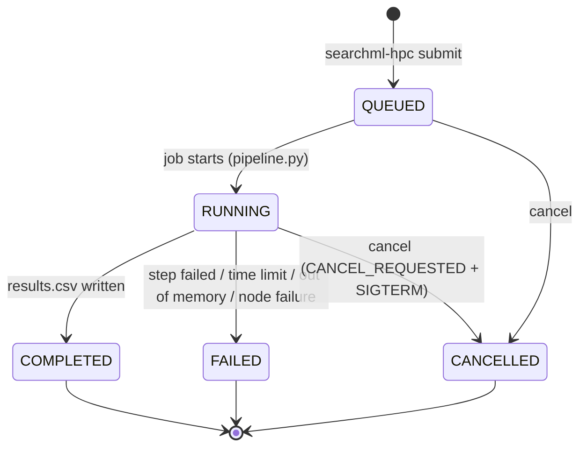

# Architecture and job protocol

This document describes how a SEARCH-ML job moves from the web portal to the cluster
and back. It is useful if you integrate SEARCH-ML into another portal or debug a job.

## Components

| Component | Where | Role |
|---|---|---|
| Web portal (PHP) | web server | Validates uploads, creates the job, polls status, displays results. Stores a small job folder per job (inputs, cached status, results preview). |
| Transport | web server | `ssh2` (PHP extension), `openssh` (the `ssh` binary) or `local` (same machine). All three run the same `searchml-hpc` commands. |
| `hpc/bin/searchml-gateway` | HPC | Forced command for the web server's SSH key: allows only `searchml-hpc` sub-commands and `scp` inside `JOBS_DIR`. |
| `hpc/bin/searchml-hpc` | HPC login node | Job manager. Prints one JSON object per command. |
| `scripts/pipeline.py` | compute node | Runs the job folder: prepare → tleap → descriptors → scoring → results. |
| `scripts/scoring.py` | compute node | Streams the library, filters, predicts, sorts, writes results/progress/summary. |

## Job lifecycle



`state.json` holds the state and timestamps; empty flag files with the same names
(`QUEUED`, `RUNNING`, `COMPLETED`, `FAILED`, `CANCELLED`) are kept for compatibility with
version 1 scripts.

If the scheduler no longer knows a job that is still `QUEUED`/`RUNNING` in
`state.json` (killed for memory, time limit, node failure), `searchml-hpc status`
marks it `FAILED` with the reason reported by `sacct` (SLURM) or a generic message.

## Submission sequence

```text
web  -> searchml-hpc prepare <job_id>                 creates JOBS_DIR/<job_id>
web  -> searchml-hpc put <job_id> receptor.pdb  < file
web  -> searchml-hpc put <job_id> job.json      < file
web  -> searchml-hpc submit <job_id>                  {"ok":true,"state":"QUEUED","scheduler_id":"12345"}
web  -> searchml-hpc status <job_id>                  (repeated; the portal caches it for a few seconds)
web  -> searchml-hpc get <job_id> results_preview.csv (once COMPLETED)
web  -> searchml-hpc get <job_id> summary.json
web  -> searchml-hpc get <job_id> results.csv[.gz]    (when a user downloads the full table)
```

Job IDs match `^[A-Za-z0-9][A-Za-z0-9_-]{5,63}$`. Uploadable names: `job.json`,
`receptor.pdb`, `custom_molecules.sdf`, `single_molecule.{sdf,mol,mol2,pdb,smi}`,
`query_ligand.{sdf,mol,mol2,pdb,smi}`.

## `job.json`

```json
{
  "version": 2,
  "mode": "forward",
  "forward": {
    "receptor": "receptor.pdb",
    "ligand": {"resname": "9UM", "chain": "A", "resseq": "413", "icode": ""},
    "source": "database",
    "database": "fda",
    "molecule_file": null,
    "filters": {"MolWt": [200, 500], "MolLogP": [-0.4, 5]}
  },
  "options": {"top": 0, "preview_rows": 2000}
}
```

- `source`: `database` (with `database` = a key of `config/databases.tsv`), `single`
  or `custom` (with `molecule_file`).
- `filters`: omitted → default `parameters/parameter.txt` for databases and no filters
  otherwise; `{}` → no filters.
- Reverse jobs use `"mode": "reverse"` and
  `"reverse": {"query_file": "query_ligand.smi", "library": "homo"}`.
- `options.top` limits the result rows (set automatically for large libraries from
  `RESULT_LIMIT_LARGE`); `options.simulate` runs a fake job for plumbing tests.

## `searchml-hpc status` reply

```json
{
  "ok": true, "job_id": "20261015-a8f3k2q9", "state": "RUNNING",
  "stage": "scoring", "stage_label": "Scoring molecules", "percent": 61.4,
  "message": "Scored 1,203,331 of 1,250,000 rows read",
  "current": 1250000, "total": 2068781, "scored": 1203331,
  "eta_seconds": 34, "rate_per_s": 36518.2,
  "queued_at": "...", "started_at": "...", "finished_at": null, "elapsed_seconds": null,
  "scheduler": "slurm", "scheduler_id": "123456", "scheduler_state": "RUNNING", "scheduler_reason": null,
  "error": null,
  "results": null
}
```

On failure `error` is `{"message", "suggestion", "details", "exit_code", "stage"}`;
when results exist `results` lists the available files and their sizes, e.g.
`{"full": 104524, "preview": 101046, "summary": 1531, "rows": 2066}`.

## `searchml-hpc ping` reply

Health and capabilities used by the portal to grey out unavailable libraries:
`version`, `host`, `scheduler`, `jobs_dir`, `disk_free_gb`, `active_jobs`,
`accepting`, `ready`, `problems[]`, `databases{key: {label, size, available, rows}}`,
`libraries{…}`, `limits{max_upload_mb, max_custom_molecules, result_limit_large,
retention_days}`.

## Pipeline stages and progress

| Stage | Forward (library) | Forward (single/custom) | Reverse |
|---|---:|---:|---:|
| prepare | 3% | 3% | – |
| tleap | 6% | 6% | – |
| features / pocket | 15–22% | 15–22% | – |
| ligand / ligand_features | – | 33–40% | 3–12% |
| scoring | 32–98% | 45–98% | 20–98% |
| finalize / done | 99–100% | 99–100% | 99–100% |

During scoring `progress.json` is rewritten every second with rows read, rows scored,
rate and ETA.
