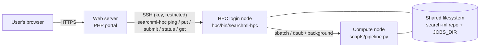

# Running SEARCH-ML web-portal jobs on your HPC

This guide installs the compute side of the SEARCH-ML web portal on a cluster (or on a
single Linux server). When it is done, jobs submitted on the website run on your
cluster and their results appear on the website automatically.

- [How the pieces fit together](#how-the-pieces-fit-together)
- [Requirements](#requirements)
- [Step 1 – Get the code](#step-1--get-the-code)
- [Step 2 – Install the compound and target libraries](#step-2--install-the-compound-and-target-libraries)
- [Step 3 – Run the HPC installer](#step-3--run-the-hpc-installer)
- [Step 4 – Review the configuration](#step-4--review-the-configuration)
- [Step 5 – Connect the web server](#step-5--connect-the-web-server)
- [Step 6 – Test end to end](#step-6--test-end-to-end)
- [Day-to-day operation](#day-to-day-operation)
- [Moving from the old set-up](#moving-from-the-old-set-up)
- [Security checklist](#security-checklist)
- [Troubleshooting](#troubleshooting)

## How the pieces fit together



- The **web server** only stores small copies (inputs, a preview of the results) and
  talks to the cluster over SSH. It runs no chemistry.
- **`hpc/bin/searchml-hpc`** on the login node is the only program the web server
  runs. It creates job folders, receives the uploaded files, submits the job, reports
  progress and streams results back. Every reply is one line of JSON.
- The **compute node** runs `scripts/pipeline.py run <job folder>`, which writes
  `state.json`, `progress.json`, `results.csv` and friends into the job folder.
- The repository and `JOBS_DIR` must be on a filesystem that both the login node and
  the compute nodes can see (with the `local` scheduler everything runs on one machine).

## Requirements

| | |
|---|---|
| Operating system | Linux (any distribution with bash ≥ 4 and Python ≥ 3.6 on the login node). |
| Account | A dedicated service account is recommended (e.g. `searchml`; the existing `baitoc` account works too). Jobs run under this account. |
| Batch system | SLURM, PBS Pro / Torque, or none (`local` mode runs jobs in the background on the same machine, a few at a time). |
| Network | The web server must reach the login node on SSH (port 22). The login node needs internet access once, to install the conda environment (or see *offline installs* below). |
| Disk | ~6 GB for the conda environment, 0.9 GB for the models, 60 MB for the bundled libraries, plus the large libraries you install (ChEMBL ≈ 1 GB, PubChem ≈ 40 GB as feature CSV) and job space (most jobs < 50 MB; full-library results can be GBs). |
| Memory | 16 GB per small job; for large libraries ~2–3 GB per scoring worker (16 workers ≈ 48–64 GB). |

## Step 1 – Get the code

Log in to the HPC as the service account and clone the repository onto the shared
filesystem:

```bash
cd /scf-data/searchml            # any shared location
git clone https://github.com/SimulatedLife/search-ml.git
cd search-ml
```

## Step 2 – Install the compound and target libraries

FDA, DrugBank, BIMP (compound libraries) and HOMO (human targets) are in the repository.
The other libraries offered on the website are large feature tables you copy onto the
cluster yourself. Expected layout (paths are relative to `datasets/`; change them in
`config/databases.tsv` and `config/libraries.tsv` if your files live elsewhere,
absolute paths are allowed):

```text
datasets/
├── fda/dataset.csv          (bundled)
├── drugbank/dataset.csv     (bundled)
├── bimp/dataset.csv         (bundled)
├── HOMO/protein.csv         (bundled, reverse screening)
├── chembl/dataset.csv       ─┐
├── coconut/dataset.csv       │ copy these, or use a parts/ folder:
├── molport/parts/*.csv.gz    │   datasets/pubchem/parts/part_0001.csv.gz ...
├── pubchem/parts/*.csv.gz    │
├── zinc/dataset.csv         ─┘
└── reverse/
    ├── mus/protein.csv          one folder per organism / taxon in config/libraries.tsv
    ├── mtb/protein.csv
    └── ...
```

A compound library is a CSV whose first column is the molecule ID followed by the 25
ligand descriptors (same header as `datasets/fda/dataset.csv`). A target library has the
same columns as `datasets/HOMO/protein.csv`.

Useful commands (inside the environment, after step 3):

```bash
python scripts/dataset_tools.py validate datasets/chembl                 # columns complete?
python scripts/dataset_tools.py validate datasets/reverse/mus --kind protein
python scripts/dataset_tools.py split /data/pubchem.csv datasets/pubchem --rows 2000000 --gzip
python scripts/dataset_tools.py count --catalog                           # writes count.txt files
python scripts/pipeline.py catalog                                        # what is installed
```

`count.txt` holds the row count so progress bars and time estimates are accurate
without counting 95 million lines at the start of every job. Libraries that are not
installed are shown greyed-out on the website, so you can add them gradually.

## Step 3 – Run the HPC installer

```bash
bash hpc/install_hpc.sh
```

It asks a few questions (or use flags, see `bash hpc/install_hpc.sh --help`):

1. Creates/updates the `search-ml` conda environment and checks the models (runs
   `install.sh`; offers to download the 830 MB Random Forest model and verifies its
   checksum).
2. Detects the batch system and asks for the partition/queue.
3. Asks for `JOBS_DIR` (default `~/searchml-jobs`) and writes `hpc/searchml-hpc.conf`.
4. Optionally adds the web server's public key to `~/.ssh/authorized_keys`,
   **restricted** to SEARCH-ML commands (you can also do this in step 5).
5. Runs `searchml-hpc ping`, a simulated job and, if you agree, a real test job
   (9KTE vs FDA drugs, 1–3 minutes).

Non-interactive example for a SLURM cluster:

```bash
bash hpc/install_hpc.sh --yes --scheduler slurm --partition compute \
     --jobs-dir /scf-data/searchml/jobs --real-test
```

<details>
<summary><b>Offline installs (no internet on the cluster)</b></summary>

Build the environment on a machine with internet and the same OS/architecture, then pack
it with [conda-pack](https://conda.github.io/conda-pack/):

```bash
conda env create -f environment.yml && conda install -n base -c conda-forge conda-pack
conda pack -n search-ml -o search-ml.tar.gz
# copy to the cluster, then:
mkdir -p ~/envs/search-ml && tar -xzf search-ml.tar.gz -C ~/envs/search-ml
~/envs/search-ml/bin/conda-unpack
```

Set `PYTHON=~/envs/search-ml/bin/python` in `hpc/searchml-hpc.conf` and run
`bash hpc/install_hpc.sh --skip-env`.
</details>

## Step 4 – Review the configuration

`hpc/searchml-hpc.conf` (template: `hpc/searchml-hpc.conf.example`) is a simple
`KEY=VALUE` file. The settings you are most likely to change:

| Key | Default | Meaning |
|---|---|---|
| `SCHEDULER` | auto | `slurm`, `pbs` or `local`. |
| `JOBS_DIR` | `~/searchml-jobs` | Job folders (shared with compute nodes). |
| `PARTITION`, `ACCOUNT`, `QOS` | empty | Passed to `sbatch` / `qsub`. |
| `SMALL_CPUS`, `SMALL_MEM`, `SMALL_TIME` | 4, 16G, 2 h | Single molecule, custom SDF, DrugBank, FDA, BIMP, reverse screening. |
| `LARGE_CPUS`, `LARGE_MEM`, `LARGE_TIME` | 16, 96G, 24 h | ChEMBL, COCONUT, MolPort, PubChem, ZINC (`size` column in `config/databases.tsv`). |
| `MODULES` | empty | Environment modules to `module load` in the batch script. |
| `EXTRA_SBATCH` / `EXTRA_QSUB` | empty | Any other scheduler flags. |
| `MAX_LOCAL_JOBS` | 2 | `local` mode: jobs running at once (others wait). |
| `MAX_ACTIVE_JOBS` | 50 | The website stops accepting jobs above this many queued + running. |
| `RESULT_LIMIT_LARGE` | 100000 | Keep only the best N hits for large libraries (0 = all). |
| `JOB_RETENTION_DAYS` | 30 | Used by `searchml-hpc cleanup`. |

The generated batch scripts are kept in each job folder (`submit.slurm` /
`submit.pbs`) so you can see exactly what was submitted. To change how jobs start
(e.g. add `#SBATCH --gres`), edit `hpc/templates/slurm.sh` or `pbs.sh`.

## Step 5 – Connect the web server

All commands in this step are run **on the web server** unless stated otherwise.

**5.1 Create a key pair for the portal** (no passphrase; readable only by the web server user,
`apache` on RHEL/CentOS, `www-data` on Debian/Ubuntu):

```bash
sudo mkdir -p /etc/searchml
sudo ssh-keygen -t ed25519 -N "" -C "searchml-web" -f /etc/searchml/id_ed25519
sudo chown -R apache:apache /etc/searchml && sudo chmod 700 /etc/searchml && sudo chmod 600 /etc/searchml/id_ed25519
sudo cat /etc/searchml/id_ed25519.pub        # copy this line
```

**5.2 Authorise it on the HPC, restricted to SEARCH-ML** (on the HPC, as the service account).
Either rerun `bash hpc/install_hpc.sh --skip-env --web-key "ssh-ed25519 AAAA... searchml-web"`,
or add this single line to `~/.ssh/authorized_keys` yourself:

```text
command="/scf-data/searchml/search-ml/hpc/bin/searchml-gateway",no-port-forwarding,no-X11-forwarding,no-agent-forwarding,no-pty ssh-ed25519 AAAA... searchml-web
```

With this line the key cannot open a shell: it can only run `searchml-hpc` commands and
copy files inside `JOBS_DIR`.

**5.3 Record the HPC host key and test** (on the web server):

```bash
sudo -u apache mkdir -p /etc/searchml && sudo -u apache sh -c 'ssh-keyscan -H hpc-login.example.org >> /etc/searchml/known_hosts'
sudo -u apache ssh -i /etc/searchml/id_ed25519 -o UserKnownHostsFile=/etc/searchml/known_hosts \
     searchml@hpc-login.example.org ping
```

You should see a JSON line starting with `{"ok":true,"version":"2.0.0",...`.

**5.4 Configure the portal.** In the web portal's `config/config.php` (see the portal's
`DEPLOY.md`):

```php
'hpc' => [
    'transport'   => 'ssh2',                      // PHP ssh2 extension; or 'openssh' (uses the ssh binary)
    'host'        => 'hpc-login.example.org',
    'port'        => 22,
    'user'        => 'searchml',
    'key_file'    => '/etc/searchml/id_ed25519',
    'pubkey_file' => '/etc/searchml/id_ed25519.pub',
    'known_hosts' => '/etc/searchml/known_hosts',
    'command'     => '/scf-data/searchml/search-ml/hpc/bin/searchml-hpc',
    'jobs_dir'    => '/scf-data/searchml/jobs',
],
```

If the web server and the "HPC" are the same machine, use `'transport' => 'local'`
(the portal then runs `searchml-hpc` directly).

## Step 6 – Test end to end

0. On the web server, run the portal's self-check as the web server user:
   `sudo -u apache php /var/www/html/search-ml/cron/doctor.php`. It tests the
   configuration, the SSH key and the connection, and lists the libraries the HPC reports.
1. Open `https://<your-portal>/search-ml/` — the status light in the header turns
   green and the libraries installed on the cluster become selectable.
2. Click **Try the example** and **Submit**. The results page shows the job moving
   through *Queued → Preparing → Descriptors → Scoring → Done*.
3. On the HPC, `hpc/bin/searchml-hpc list` shows the job and `squeue -u $USER` (SLURM)
   shows it while it runs.

## Day-to-day operation

```bash
H=/scf-data/searchml/search-ml/hpc/bin/searchml-hpc
$H ping                    # health: scheduler, disk, installed libraries, problems
$H ping --deep             # also imports RDKit/AmberTools/models in the environment
$H list --limit 50         # recent jobs and their state
$H status <job_id>         # one job (JSON)
less $JOBS_DIR/<job_id>/job.log           # full log of a job
$H cancel <job_id>
$H cleanup --dry-run       # what would be deleted (finished jobs older than JOB_RETENTION_DAYS)
$H selftest --real         # end-to-end test with the example
```

Recommended crontab on the HPC (removes old job folders nightly):

```cron
17 3 * * *  /scf-data/searchml/search-ml/hpc/bin/searchml-hpc cleanup >/dev/null 2>&1
```

**Updating:** `git pull` in the repository, then `bash hpc/install_hpc.sh --skip-env`
(or without `--skip-env` if `environment.yml` changed). Your `searchml-hpc.conf` is
backed up before it is rewritten; running jobs are not affected.

**Failed jobs** keep their folder: `error.log` explains the reason, `job.log` has the
details and `scheduler.out` has the batch system's output. Jobs that hit the time limit
or run out of memory are reported as such on the website (from `sacct` on SLURM).

## Security checklist

- [ ] The web server's key is in `authorized_keys` **with** the `command="…searchml-gateway"` prefix.
- [ ] The private key on the web server is mode 600 and owned by the web server user.
- [ ] Password authentication for the service account is no longer used by the portal (and the old password was changed).
- [ ] `JOBS_DIR` is not world-readable (`chmod 750`); uploads may be unpublished research data.
- [ ] `hpc/searchml-hpc.conf` is not world-writable.

## Troubleshooting

| Symptom | Check |
|---|---|
| Website says *Compute server offline* | From the web server run the `ssh … ping` test in 5.3. *Permission denied*: key not authorised or wrong file permissions. *Host key verification failed*: refresh `known_hosts`. |
| `{"ok":false,"error":"rejected: …"}` | The gateway refused the command; make sure `command=` points to `hpc/bin/searchml-gateway` in this repository. |
| Jobs stay *Queued* | `squeue -j <id>` / `qstat <id>`: partition limits, account or QoS. The website shows the scheduler's reason. With `local`, `MAX_LOCAL_JOBS` jobs are already running. |
| *The compute environment is not set up correctly* | `searchml-hpc ping --deep`; the batch script could not activate the environment (check `CONDA_BASE`, `CONDA_ENV`, `PYTHON`, `MODULES`). |
| *tleap could not process the structure* | A problem with the uploaded PDB (see `leap.log` in the job folder); not a server fault. |
| *The job reached the cluster time limit* | Raise `LARGE_TIME`, or lower `RESULT_LIMIT_LARGE` / install the library as `parts/`. |
| *ran out of memory* | Raise `LARGE_MEM` or lower `LARGE_CPUS` (each worker needs 2–3 GB). |
| Library greyed out on the website | `python scripts/pipeline.py catalog` shows where it is expected; fix the path in `config/databases.tsv`. |
